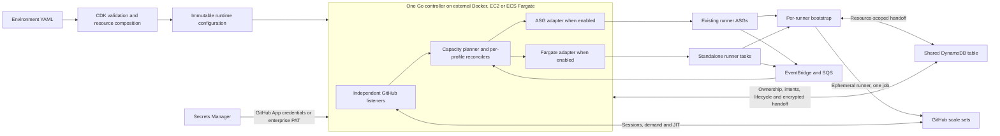
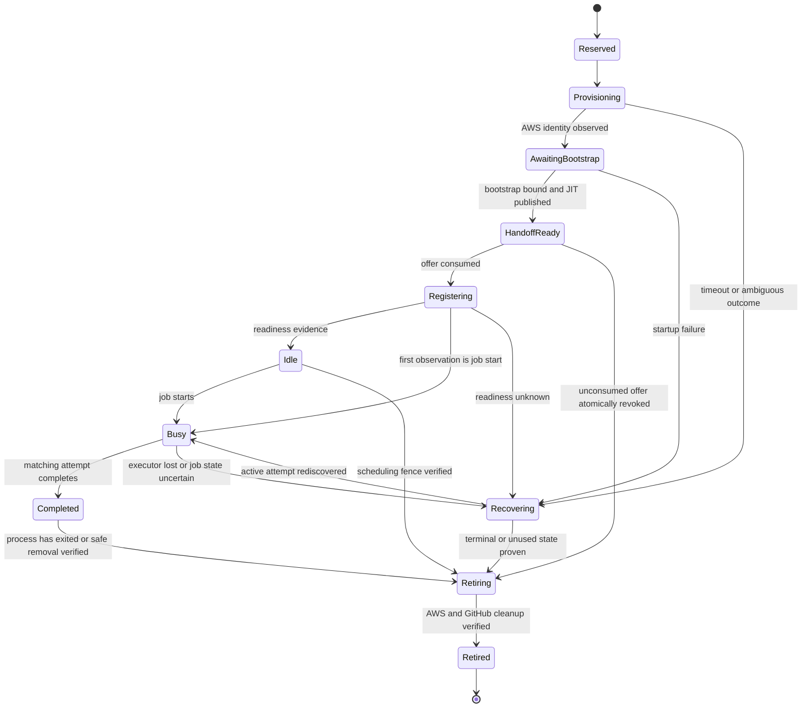

# AWS GitHub Runner Scale Set Controller

Implementation plan for approval · 21 November 2026

## 1. API and repository baseline

The application worktree starts at `e751880` with only `.gitignore` tracked. There is no existing application, CDK stack, or deployment contract to preserve. API review used the adjacent official `actions/scaleset` checkout, including the `v0.5.0` tag at `af394d86c0d5024225238b0209043c70193bcfe6` and checkout HEAD `716908e507993947ada4273aecf2361c02e5836c`. The Go module index confirms the tag. Use the tag as the initial implementation candidate and keep the first pinned build subject to the SDK contract tests below. The tag declares Go 1.27.3. The SDK is in public preview. [SDK release API](https://pkg.go.dev/github.com/actions/scaleset@v0.5.0) · [Official SDK source](https://github.com/actions/scaleset/tree/v0.5.0)

| Concern | Inspected API and design implication |
| --- | --- |
| GitHub authentication | The v0.5.0 SDK exposes `NewClientWithGitHubApp` and `NewClientWithPersonalAccessToken`. For an enterprise URL (`https://<host>/enterprises/<slug>`), the PAT client exchanges the credential through `POST /enterprises/{enterprise}/actions/runners/registration-token`. GitHub documents PAT (classic) with `manage_runners:enterprise` for this endpoint and excludes fine-grained PATs and GitHub App tokens. Use a classic PAT for enterprise scope and GitHub App installations for organisation or repository scope. [SDK client source](https://github.com/actions/scaleset/blob/v0.5.0/client.go) · [Enterprise registration token API](https://docs.github.com/en/enterprise-cloud@latest/rest/actions/self-hosted-runners#create-a-registration-token-for-an-enterprise) |
| GitHub identity and provisioning | `NewClientWithGitHubApp`, `GetRunnerGroupByName`, `GetRunnerScaleSet`, `GetRunnerScaleSetByID` and `CreateRunnerScaleSet` cover authenticated lookup and explicit creation. `GenerateJitRunnerConfig` takes a scale set ID and a runner name and work folder. `GetRunner` and `GetRunnerByName` return a runner reference with ID, name and scale set ID. Existence alone cannot prove online or idle status. `RemoveRunner` exists and the SDK can classify a job-still-running error. The scheduling race around removal needs live verification. [SDK client and types](https://pkg.go.dev/github.com/actions/scaleset@v0.5.0) |
| GitHub sessions | `MessageSessionClient` creates a session. `Session` exposes initial statistics, `GetMessage` long-polls with max capacity and cursor, `AcquireJobs` submits offered request IDs, `DeleteMessage` acknowledges processing, and `Close` deletes the owned session. The SDK refreshes expired queue tokens. The example acquires offered jobs and scales from `TotalAssignedJobs`, which includes running jobs. Use these SDK primitives so the controller can bound acknowledgement time, fence ownership and persist receipt before acknowledging. [SDK session client](https://github.com/actions/scaleset/blob/v0.5.0/session_client.go) · [Official Docker example](https://github.com/actions/scaleset/tree/v0.5.0/examples/dockerscaleset) |
| GitHub routing | Scale set registration and runner-group membership are distinct. Validate the registered labels and group after lookup or creation. For GHES, multiple labels depend on appliance version and feature configuration. Prove the proposed `runs-on` selectors and group restrictions in the target GitHub environment. [GitHub runner reference](https://docs.github.com/en/actions/reference/runners/self-hosted-runners) · [SDK GHES support](https://github.com/actions/scaleset/blob/v0.5.0/README.md#github-enterprise-server) |
| EC2 Auto Scaling | Use SDK v2 `DescribeAutoScalingGroups`, `DescribeScalingActivities`, `DescribePolicies`, `DescribeScheduledActions` and EC2 read APIs for membership and preflight. `SetDesiredCapacity` accepts an absolute target and can initiate ASG-selected scale-in. Use it only for increases. `TerminateInstanceInAutoScalingGroup` targets a specific member and can decrement desired capacity. Measure decrements for supported weighted groups. [SetDesiredCapacity](https://docs.aws.amazon.com/autoscaling/ec2/APIReference/API_SetDesiredCapacity.html) · [Targeted termination](https://docs.aws.amazon.com/autoscaling/ec2/APIReference/API_TerminateInstanceInAutoScalingGroup.html) · [Instance weights](https://docs.aws.amazon.com/autoscaling/ec2/userguide/ec2-auto-scaling-mixed-instances-groups-instance-weighting.html) |
| Amazon ECS | SDK v2 `RunTask` with a revision-qualified task definition, explicit cluster, `FARGATE`, `awsvpc` configuration and a durable `clientToken`. Read `tasks` and `failures` even after HTTP success. Use `ListTasks`, `DescribeTasks` and `StopTask` with eventual-consistency handling. `startedBy` can correlate an ambiguous launch. Token validity is finite. [RunTask](https://docs.aws.amazon.com/AmazonECS/latest/APIReference/API_RunTask.html) · [ECS idempotency](https://docs.aws.amazon.com/AmazonECS/latest/developerguide/ECS_Idempotency.html) |
| Shared state and infrastructure | SDK v2 DynamoDB conditional and transactional APIs support atomic state changes and coordination within one Region. ECS and ASG APIs are outside those transactions. CDK v2 can reference existing infrastructure, including `Cluster.fromClusterAttributes` with the imported VPC for controller hosting. ECS clusters are regional and placement in the supplied VPC comes from task/service networking. [DynamoDB transactions](https://docs.aws.amazon.com/amazondynamodb/latest/developerguide/transaction-apis.html) · [CDK Cluster API](https://docs.aws.amazon.com/cdk/api/v2/docs/aws-cdk-lib.aws_ecs.Cluster.html) |

### Offline SDK contract tests

The tests in `tests/sdkcontract` drive the pinned SDK clients through scripted HTTP exchanges. All endpoints, credentials and responses are test data. Unexpected requests fail the test, so the fixtures can check wire counts after an ambiguous response.

| SDK surface | Offline evidence |
| --- | --- |
| GitHub authentication and routing | Enterprise PAT registration-token paths on GitHub.com, GHE.com and GHES, GitHub App installation-token exchange, runner-group resolution, scale-set name lookup, and outbound labels and runner settings during creation. Check the portable selector grammar and label readback on the target GitHub host. |
| GitHub session and recovery | Initial statistics, cursor and capacity headers, token refresh, job acquisition results, ack and session close. Verify a one-attempt JIT request and deterministic-name lookup after a lost response. Header transmission does not establish the service's zero-capacity behavior or assignment ordering. |
| AWS execution | ASG inventory, weighted capacity and protection fields, single-attempt desired-capacity writes and targeted termination. ECS cluster and task revision preflight, count-one launch, identical explicit-token replay, task lookup and stop. Fixtures cover the wire format and response parsing. Live tests cover scale-in behavior, idempotency expiry and eventually consistent recovery. |
| AWS supporting services | EC2 instance and launch-template reads, DynamoDB transaction and conditional one-time handoff, Secrets Manager version selection, IAM role IDs, STS caller IDs, versioned S3 reads, and SQS receipt handling. IAM and per-executor identity isolation still require the live checks in section 11. |

Run the suite with `go test -race ./tests/sdkcontract` using the pinned Go toolchain. Re-run it when upgrading either SDK. Section 11 lists the service behaviors that require a sandbox canary.

## 2. Architecture and ownership

One Dockerised Go controller runs independent concurrent listener and reconciliation workers. Each profile owns one homogeneous GitHub scale set and one execution backend. The shared table holds lifecycle and ownership, while GitHub supplies job demand. AWS inventory and lifecycle events supply resource observations. Use one AWS account and Region per controller deployment initially. Deploy separate controller environments for other accounts or Regions.

The controller has one Go entry point at the repository root. `main.go` wires together packages named for their features. The repository layout and test placement conventions are documented in `AGENTS.md`.



The core consumes a normalized demand view, normalized executor observations and durable intents. Each provider supplies typed configuration validation, inventory discovery, capacity translation, intent execution and cleanup. It returns provider-neutral observations with ownership, establishment deadlines, occupancy, terminal evidence and drift. The backend registry is assembled after validation from the profiles in `active` or `draining` state. A provider failure backs off and degrades its profiles independently. A shared state or ownership failure blocks all affected mutations. No Kubernetes dependency, runner ECS service, or separate always-on bootstrap service is needed.

| Profile purpose | Supported execution and routing |
| --- | --- |
| `copilot-cloud-agent` | Dedicated runner group and scale set with a unique selector. Start with Ubuntu x64 on ASG, restricted to approved repositories. GitHub documents Ubuntu x64 and Windows x64 for cloud agent. Any additional combination needs its own image, firewall and live canary. Configure organisation defaults or `copilot-setup-steps.yml`. Use the custom controller for Copilot cloud agent only. GitHub specifies ARC for self-hosted Copilot code review. [Cloud agent runner configuration](https://docs.github.com/en/copilot/how-tos/administer-copilot/manage-for-organization/configure-runner-for-coding-agent) · [Cloud agent environment](https://docs.github.com/en/copilot/how-tos/copilot-on-github/customize-copilot/customize-cloud-agent/customize-the-agent-environment) · [Copilot code review](https://docs.github.com/en/copilot/how-tos/copilot-on-github/set-up-copilot/configure-runners) |
| `fargate-compatible` | One standalone Fargate task per Linux x64 or arm64 runner in the initial release. Workflows must run without a Docker daemon, Docker container actions, job/service containers or privileged operations. Select these workflows through group and label policy. A workflow that needs Docker must target an eligible EC2 profile explicitly. Windows Fargate is an AWS capability, with separate runtime constraints and a later compatibility gate. [Fargate task definition differences](https://docs.aws.amazon.com/AmazonECS/latest/developerguide/fargate-tasks-services.html) |
| `docker` | Separate ASGs and scale sets for Linux x64, Linux arm64, or Windows x64 as required. Pin each host/runner image and validate container compatibility. GitHub Actions job and service containers require Linux, so Windows Docker profiles are for compatible Windows tooling called by steps, with the Windows base image/host combination verified. Keep the Docker host and its privileges inside the one-job instance boundary. [GitHub service containers](https://docs.github.com/en/actions/use-cases-and-examples/using-containerized-services/about-service-containers) |

## 3. Configuration contract

Keep canonical authored YAML under `cdk/config/*.yaml`. Publish a versioned JSON Schema for its data model and a versioned runtime schema. CDK parses YAML in a mode that flags duplicates before conversion and rejects aliases, merge keys, custom tags, non-string keys and multi-document input. Validate with closed object schemas, explicit tagged unions, cross-field checks and version rejection. The Go loader validates the runtime schema independently, rejects duplicate and unknown JSON keys and runs the same semantic rules. Shared positive and negative fixtures are the compatibility contract. Validate the whole file even for disabled profiles. Resolve AWS dependencies and enforce uniqueness only for provisioned or draining profiles. Use explicit numeric bounds, AWS identifier/account/region checks and a URL allowlist. For managed scale set names and labels, propose a portable selector policy of 1–63 ASCII letters, digits, underscores or hyphens with an alphanumeric first character. Reject duplicate labels after case-folding and verify the final grammar against GitHub in M1. Existing runner group names follow GitHub lookup semantics.

| YAML path | Proposed v1 contract |
| --- | --- |
| `apiVersion`, `kind`, `metadata.name` | Require `runners.example/v1alpha1`, `RunnerController` and a stable environment name. Environment identity includes account, Region and name. |
| `spec.aws` | Require account and Region. Each CDK-managed network consumer selects a named existing VPC/subnet/security-group tuple from `spec.networks`. A network definition carries a VPC ID, subnet ID/AZ pairs and security-group IDs. Imported values are checked against reality during preflight. External hosting and ASG-only execution can omit the network catalog when there are no managed network consumers. |
| `spec.mode`, `spec.dryRun` | `mode` defaults to `dry-run`. `active` requires an explicit deployment setting and an active IAM policy. `dryRun.demand` defaults to `none`, or selects a local snapshot/replay path or a read-only S3 object with an expected digest. `dryRun.inspectAws` defaults to false. Dry-run has no configured GitHub demand credential flow. |
| `spec.controller` | Require `image` pinned to a registry digest and `hosting` union. `external` has an `identity` union (existing EC2 principal with scoped role attachment or explicit role assumption, or an existing Roles Anywhere trust/profile). `ec2` requires a network ref, AMI ID and instance type. `ecs-fargate` requires a network ref, cluster ref, architecture, and valid CPU/memory combination. |
| `spec.tracking.table` | `create` derives a stable physical name from the environment, or `import` requires a table name and ownership/schema preflight. Retention/PITR and encryption requirements apply to both. |
| `spec.ecsClusters` | Optional named catalog, needed only for ECS consumers. `import` takes a cluster ARN. `create` explicitly declares a name. A host and runner may share a compatible cluster or select separate clusters. A create entry resolves only when selected by a consumer with a defined network placement. |
| `spec.github` | Named connections with `scopeURL` and a required `auth` union. `github-app` takes a Secrets Manager `secretArn` and requires an organisation or repository URL. `enterprise-pat` takes a Secrets Manager `secretArn` and requires an enterprise URL of the form `https://<host>/enterprises/<slug>`. Reject mismatched scopes and credential values in configuration. Require an approved HTTPS host and a trusted GHES CA where applicable. Profile GitHub mapping has a connection ref, existing group name, scale set name, optional pinned numeric scale set ID, and exact label list. `registration` defaults to `existing`. `create-if-missing` creates only in active mode after an exact group/name lookup. Treat changed group, ID or labels as an explicit migration. |
| `spec.profiles[]` | At least one profile, with at least one `active` or `draining`. Require immutable ID, state (`active\|draining\|disabled`), purpose, supported OS/architecture, routing, and capacity. Require `0 <= idleReserve <= maxRunners` and `maxRunners > 0`. Validate startup timeout and per-profile limits. The effective advertised max is also bounded by verified backend limits. |
| `profiles[].provisioner` | `asg` requires a group ARN, capacity units mode (`instances` or `fixed-weight` with a positive integer weight), bootstrap role ARN and protocol version. `fargate` requires cluster and network refs, a full task definition ARN with revision, runner container name, bootstrap task role ARN, execution role ARN, and protocol version. Reject keys from the other variant. `disabled` profiles do not activate or retain backend resources after verified drain. |

Require one active/draining profile per GitHub host/scope/group/scale set identity and one owner per imported ASG. Resolve and recheck by canonical ARNs, GitHub group and set IDs, and case-insensitive names. Require an unambiguous workflow selector per profile. For v1, keep labels disjoint across managed profiles within a GitHub scope and require each selector list to include its scale set name. Preflight overlapping legacy selectors and group access. Validate subnet/VPC/security-group associations and the controller/runner network boundary, Fargate architecture and pinned definition role matches, ASG homogeneity, and actual ASG limits. Allow task definition reuse only for the same trust boundary and compatible purpose, OS and architecture. Track each profile independently using intent IDs and ownership tags.

CDK creates a deterministic, normalized runtime JSON artifact from the validated YAML. Resolve created resources with stable physical names and the deployment account/Region. Use canonical names or ARNs for imports, and add deployment dependencies explicitly. Publish the runtime artifact by content digest as a nonsecret, versioned S3 asset with restricted access. Pin the digest in the managed host launch settings. External hosts can mount the exact artifact read-only or fetch the same digest using AWS IAM. The Go process verifies the digest and validates before opening clients, then reports mode and configuration version. No secret values enter YAML, synthesized templates, assets, Docker layers or logs.

The CDK entry points live in `cdk/bin/`, the configuration compiler in `cdk/lib/config/`, and the environment YAML and versioned schemas in `cdk/config/`. TypeScript tests live in `cdk/test/`. From the repository root, compile a YAML file to a new local JSON file and print the SHA-256 of its exact bytes:

```sh
npm --prefix cdk run config:emit -- ../testdata/config/asg-only-external.yaml /tmp/runner-runtime.json
```

The runtime envelope contains the normalized `config`, the resolved tracking table name, and the ARNs of selected ECS clusters. Its bytes are independent of YAML comments and mapping key order. The shared YAML and runtime fixtures in `testdata/config/` cover ASG-only, Fargate-only, and mixed environments. For a custom GHES host, `spec.github.<connection>.caBundlePath` identifies the trusted CA file supplied by the controller host.

Validate the emitted artifact with `go run . config verify --file /tmp/runner-runtime.json --sha256 <digest>`. The command checks the exact bytes against the supplied digest and prints the environment, mode and selected runner backends. It uses the schemas embedded from `cdk/config/schema/` and performs no AWS or GitHub calls.

### EC2-only example on an existing external Docker host

Identifiers are illustrative and belong only to capabilities shown in the example.

```yaml
apiVersion: runners.example/v1alpha1
kind: RunnerController
metadata:
  name: engineering-dev
spec:
  aws:
    account: '111122223333'
    region: ap-southeast-2
  mode: dry-run
  dryRun:
    demand:
      type: snapshot
      path: /input/demand.json
    inspectAws: true
  controller:
    image: '111122223333.dkr.ecr.ap-southeast-2.amazonaws.com/controller@sha256:0123456789abcdef0123456789abcdef0123456789abcdef0123456789abcdef'
    hosting:
      type: external
      identity:
        type: ec2-instance-profile
        principalRoleArn: arn:aws:iam::111122223333:role/existing-controller-host
  tracking:
    table:
      type: create
  github:
    engineering:
      scopeURL: https://github.com/example-engineering
      auth:
        type: github-app
        secretArn: arn:aws:secretsmanager:ap-southeast-2:111122223333:secret:github-app-engineering-a1b2c3
  profiles:
    - id: linux-docker
      state: active
      purpose: docker
      platform: { os: linux, arch: x64 }
      capacity: { idleReserve: 0, maxRunners: 12, startupTimeoutSeconds: 600 }
      github:
        connection: engineering
        runnerGroup: Linux-Docker
        scaleSet: linux-docker
        labels: [linux-docker]
        registration: existing
      provisioner:
        type: asg
        groupArn: 'arn:aws:autoscaling:ap-southeast-2:111122223333:autoScalingGroup:12345678-1234-1234-1234-123456789012:autoScalingGroupName/engineering-linux-docker'
        capacityUnits: { type: instances }
        bootstrapRoleArn: arn:aws:iam::111122223333:role/runner-linux-bootstrap
        bootstrapProtocol: v1
```

### Fargate-only example expressed as a change to the base

Use the following as a `spec` excerpt. Keep `aws`, `mode`, `tracking`, `github` and `controller.image` from the base. With managed hosting, omit the base `dryRun` block for demand-unknown mode, or select a read-only S3 snapshot. Replace the full `profiles` list for Fargate-only. Append the Fargate profile for mixed execution. To keep external hosting, keep the base `controller.hosting` block. A newly created cluster is selected with `{ type: create, name: engineering-dev-runners }` in place of the import.

```yaml
controller:
  hosting:
    type: ecs-fargate
    network: controller-private
    cluster: engineering
    cpuArchitecture: x64
    cpu: 512
    memoryMiB: 1024
networks:
  controller-private:
    vpcId: vpc-0123456789abcdef0
    subnets:
      - { id: subnet-0123456789abcdef0, az: ap-southeast-2a }
      - { id: subnet-0123456789abcdef1, az: ap-southeast-2b }
    securityGroupIds: [sg-0123456789abcdef0]
  runner-private:
    vpcId: vpc-0123456789abcdef0
    subnets:
      - { id: subnet-0123456789abcdef2, az: ap-southeast-2a }
      - { id: subnet-0123456789abcdef3, az: ap-southeast-2b }
    securityGroupIds: [sg-0123456789abcdef1]
ecsClusters:
  engineering:
    type: import
    arn: arn:aws:ecs:ap-southeast-2:111122223333:cluster/engineering
profiles:
  - id: linux-shell
    state: active
    purpose: fargate-compatible
    platform: { os: linux, arch: arm64 }
    capacity: { idleReserve: 0, maxRunners: 24, startupTimeoutSeconds: 600 }
    github:
      connection: engineering
      runnerGroup: No-Docker
      scaleSet: linux-shell
      labels: [linux-shell]
      registration: create-if-missing
    provisioner:
      type: fargate
      cluster: engineering
      network: runner-private
      taskDefinitionArn: 'arn:aws:ecs:ap-southeast-2:111122223333:task-definition/linux-shell-runner:7'
      runnerContainer: runner
      bootstrapRoleArn: arn:aws:iam::111122223333:role/fargate-runner-bootstrap
      executionRoleArn: arn:aws:iam::111122223333:role/fargate-runner-execution
      bootstrapProtocol: v1
```

### Enterprise PAT connection example

Add this connection to `spec.github` and set the selected profile's `github.connection` to `corporate` and `github.runnerGroup` to an existing enterprise runner group. Connections using GitHub Apps and enterprise PATs can coexist in the same controller. The connection can be used with either runner provisioner and any controller host. For GHE.com or GHES, supply the approved host and verify the same enterprise path against the target environment. [SDK URL parsing](https://github.com/actions/scaleset/blob/v0.5.0/config.go) · [GitHub enterprise registration token API](https://docs.github.com/en/enterprise-cloud@latest/rest/actions/self-hosted-runners#create-a-registration-token-for-an-enterprise)

```yaml
corporate:
  scopeURL: https://github.com/enterprises/example-corporate
  auth:
    type: enterprise-pat
    secretArn: arn:aws:secretsmanager:ap-southeast-2:111122223333:secret:github-enterprise-pat-a1b2c3
```

A compatible new profile requires only a YAML change and the normal versioned configuration rollout. Its GitHub group and selected compute/image resources must already exist or use an explicitly supported create option. The operator can use a new profile ID, group selector and backend reference for a replacement. `draining` is an enabled cleanup state and keeps resource bindings and permissions. It stops acquiring new jobs, advertises zero where verified, and uses an effective idle reserve of zero. It provisions only to cover the deficit for already assigned jobs within policy. The configured reserve stays available if the profile later returns to active mode. Remove or disable the profile after two complete, separated passes confirm no assigned/busy work, active handoffs, unresolved intents, or owned executor resources requiring cleanup. An ASG physical floor may leave explicitly parked, unregistered instances under the ASG owner's control. Keep a retired-profile tombstone and pass the retirement gate before CDK removes policy/rule bindings. This gate runs in the deployment preflight and is also enforced at active runtime. A missing active binding degrades startup with no silent adoption or cleanup. Retiring the last profile entails draining and stopping the environment rather than deploying an empty controller configuration.

## 4. CDK composition and deployment ownership

Implement a standalone TypeScript CDK app under `cdk/`. Compose tracking/configuration, optional backend integration, and one hosting construct. Import resource attributes instead of taking CloudFormation ownership of existing infrastructure. Use stable logical IDs independent of profile list order. Allow offline synthesis with supplied attributes and deterministic fixtures. Live resource verification belongs to a separate preflight step. AWS resource changes require the normal reviewed CDK change set.

| Selector | CDK creates or configures | Existing dependencies |
| --- | --- | --- |
| All hosting modes | Retained encrypted lifecycle table with PITR if `create`, or reference if `import`. Immutable runtime config asset, config read permission, mode-specific controller IAM, log group, baseline alarms and Secrets Manager references for active use. | Registry image digest, secret metadata and hosting identity as configured. Imported table key, expiration and security settings remain with its owner. |
| `external` | Supporting resources and a scoped policy or assumable controller role based on the declared principal. No compute or load balancer. | Docker host, host-managed registry access, temporary AWS credentials, networking and supervisor. |
| `ec2` | Dedicated controller EC2 instance, instance profile, IMDSv2, encrypted root volume and boot/supervisor configuration. No runner ASG or controller ASG. | Existing VPC, subnets and security groups, approved AMI, image and instance type. |
| `ecs-fargate` host | Controller task definition, controller task and execution roles, one-replica ECS service, private task networking, health check and deployment circuit breaker. Use stop-before-start rollout (`minHealthyPercent: 0`, `maxHealthyPercent: 100`) and retain runtime ownership fencing. A short control-plane gap leaves runners executing. | Imported cluster or explicitly created cluster, existing VPC, subnets and security groups. ECS execution role handles image/log access. |
| Active or draining ASG profiles | EventBridge rules scoped to the configured ASG names, SQS targets, redrive/DLQ and controller rights. In active mode install the approved bootstrap policy scoped to the existing role, or output the exact policy for the role owner if externally managed. Plan baseline uses ASG event notifications and polling with no lifecycle hook attached to an imported ASG. | Existing ASG, launch template, role and approved bootstrap. ASG owner preconfigures protection and changes any group or launch-template settings through its established process. |
| Active or draining Fargate profiles | EventBridge task-state rules scoped to selected runner clusters and definitions, SQS targets/redrive and relevant IAM. Provisioning calls launch standalone tasks. CDK references the supplied revision; no runner ECS service or new runner task definition is required. | Existing task definition revision, roles, network and selected cluster. App verifies the imported definition contract before enabling a profile. |
| Selected cluster with `type: create` | One cluster per distinct selected create entry, reused when host and runner reference it. | Consumers place tasks in their supplied existing VPC/subnets. |
| Selected cluster with `type: import` | Reference only. | Existing cluster with Fargate launch capability and available networking/quota. |

Effective predicates are independent. ASG clients/integration require a configured enabled ASG profile. Fargate runner clients/integration require a configured enabled Fargate profile. A selected ECS host requires its own execution resources and this does not activate Fargate runner provisioning. An ASG-only external or EC2-hosted synthesis must contain zero ECS clusters, task definitions, services and provisioning permissions. An ASG-only ECS-hosted synthesis may contain only controller-host ECS resources, with no runner `ecs:RunTask` or `ecs:StopTask` grants. Fargate-only synthesis must have no runner Auto Scaling integration or policy in any hosting mode. Dry-run synthesis omits runner mutation IAM, secret-value access and bootstrap policy changes. Dry-run can opt into read-only inventory and use existing or fixture state. Provisioning IaC support resources is an independent deployment operation from running the dry-run application.

External EC2 uses IMDSv2 and an explicitly authorized instance profile or scoped assumed role. Configure container metadata reachability deliberately, for example an approved bridge hop limit, while blocking access from unrelated workloads. A non-EC2 external host uses temporary credentials from IAM Roles Anywhere with a mounted, protected host credential helper and trust material. The dedicated host uses a systemd-managed non-root, read-only controller container with a pinned digest and read-only config, no Docker socket mount and no published public management port. Pre-pull images with the host identity, forward logs, fail closed on bad configuration, restart with backoff, and send SIGTERM with bounded grace. The external host owner maintains OS and Docker patches, credential helper and certificates, registry/config availability, egress, restart policy and health monitoring. Go fetches the configured GitHub credential directly from Secrets Manager in active mode. [Roles Anywhere credential provider](https://docs.aws.amazon.com/sdkref/latest/guide/access-rolesanywhere.html) · [ECS IAM roles](https://docs.aws.amazon.com/AmazonECS/latest/developerguide/security-iam-roles.html)

## 5. Listener and reconciliation semantics

1. Acquire the environment ownership lease and claim profile mappings. Run discovery before performing effects. Use one supervised long-poll loop per resolved scale set and one serialized effect lane per profile. Bound concurrency and outstanding operations per backend, AWS account and GitHub credential. Share rate-limit budgets among profiles that use the same installation or enterprise PAT.
2. Create a uniquely owned session and ingest its initial statistics. Poll with the last acknowledged message ID and the effective capacity ceiling. If a session is replaced, start with the new session's initial statistics and cursor; scope delivery IDs to session and scale set. Verify the drain behavior of the max-capacity header, including zero, in a test scale set.
3. Durably record a sanitized inbox entry before processing. Handle `JobAvailable` by recording acquisition intent and passing a bounded set of request IDs to `AcquireJobs`. Reserve distinct request IDs against the admission budget before calling GitHub. Keep both uncertain requests and successful acquisitions awaiting assignment accounting reserved across polls, replay and restart. Count each request once across these states. Release a reservation only when correlated assignment evidence and the verified snapshot ordering show it is included in the assigned total, or when verified rejection or terminal evidence shows it consumes no slot. Keep ambiguous IDs reserved and surface them for recovery. An aggregate increase alone cannot identify which IDs it covers. Bound each batch by the effective ceiling after assigned demand, remaining reservations and occupied or unknown slots outside the assigned count. Wait for authoritative assigned statistics to increase desired runner count. Persist job-attempt facts and latest statistics with monotonic revision checks. Acknowledge only after durable acceptance and acquisition handling or a durable retry outcome that guarantees work can be recovered. Reconciliation and AWS side effects run outside the message acknowledgement path. Persist the job facts and acquisition evidence needed for replay before acknowledging. On a lost acquire or ack response, reconcile or replay according to the tested session contract; never use a duplicate event as an increment to demand.
4. Plan `target = min(effectiveMax, TotalAssignedJobs + effectiveIdleReserve)`. An active profile uses its configured warm reserve. A draining profile always uses zero. With no assigned jobs, the draining runner target is zero even if the ASG must retain unregistered instances at its physical floor. The available runner deficit is `max(0, target - eligibleServing - crediblePending)`. Serving includes busy and eligible idle runners, counted once each. Separate queued demand, active jobs, idle runners, credible pending launches, and unresolved occupiers. Credible pending capacity has verified backing, matching provenance, a deadline, and a path to readiness. An unresolved resource can consume a hard capacity slot without satisfying demand. Enforce the profile cap across observed resources, pending operations and unexpired reservations. Preserve busy and uncertain capacity even when above target.
5. Reconcile periodically and on GitHub, AWS and bootstrap updates. An empty GitHub poll supplies no new statistics. Continue recovery and known safe cleanup while waiting for fresh demand; use the last current-session sample as the best available signal under a bounded freshness policy. After it crosses that threshold, pause demand-driven changes and raise a stale-signal alert. On persistent stale statistics in an otherwise healthy session, bound scale-out by caps, startup failure budgets and cooldowns. Use a controlled session refresh and surface discrepancies for operator review. Never convert missing demand into zero. Rate-limit launch and retire actions separately.
6. Persist intent before each mutating external call. Recheck identity, health, lease, state, and known in-flight effects before execution. Reconcile on read-after-write using the provider-specific consistency window. Provisioning, issuing JIT and retiring are separate effects with separate recovery evidence. The journal owns retries of ambiguous writes. For GitHub JIT generation, scale set creation, session creation and other writes lacking a verified idempotency guarantee, use `scaleset.WithRequestRetry` with a one-attempt budget for the effect request. For AWS ASG writes without an idempotency token, also disable SDK-level retries of ambiguous outcomes. Scope retry settings so ordinary reads and safe idempotent operations keep bounded retries. On retryable rate-limit responses, preserve service backoff hints in the journal. Test effect request counts with a transport that drops the response after simulated server commit. [Scale Set SDK retry control](https://github.com/actions/scaleset/blob/v0.5.0/common_client.go#L529) On shutdown, stop admitting work, cancel polls, complete or persist in-flight work with bounded deadlines, close only owned sessions, then release ownership once mutators are quiescent. Leave executor resources and active jobs running.

### Lifecycle and retirement



Maintain lifecycle state alongside orthogonal observations. Persist the executor ID and incarnation, GitHub runner ID/name, readiness evidence, currently observed attempt, completion and AWS terminal observations independently. A first observation may be a start or completion, and late observations cannot resurrect retired state. Correlate start and completion with runner identity and the GitHub attempt/request ID. A canceled assignment without a matching runner and attempt cannot authorize cleanup. Keep contradictory or missing observations in a protected recovery state.

Readiness is a signal from the pinned runner/bootstrap integration after connecting, reinforced by GitHub job events and aggregate registration counts. An SDK runner reference only proves identity; lack of start events does not prove idle. Retire confirmed completed executors after the process has exited or the server-side runner registration is safely fenced and a bounded log-flush window has elapsed. For released idle runners require a verified GitHub-side scheduling fence before terminating the executor. Prototype `RemoveRunner` and prove it refuses busy and already-dispatched jobs even when a start event is delayed. If the contract cannot be proven, allow automatic retirement only for completed, authoritatively dead, or atomically revoked unconsumed executors. Leave connected idle executors protected, show their cost and drain impact, and use an operator-confirmed safe retirement procedure. Automated reclamation of registered idle capacity is gated on this evidence.

### ASG adapter

An existing ASG is eligible once its launch path can produce a clean EC2 instance that starts one JIT runner for the configured scale set. The ASG may be empty before activation. Verify the owner-approved AMI and launch-template revision and prove boot, JIT registration, one job and exit on an isolated canary. Existing persistent runners and runners registered through the ordinary runner-group registration path, including registrations made with `--ephemeral`, remain under the legacy owner's control. Their instances do not count as usable scale set capacity. [GitHub ephemeral runner guidance](https://docs.github.com/en/actions/reference/runners/self-hosted-runners#ephemeral-runners-for-autoscaling) · [Scale Set SDK](https://pkg.go.dev/github.com/actions/scaleset@v0.5.0)

- **Incompatible launch path.** At initial preflight, mark the ASG profile unavailable and report its prerequisites before opening a job-acquiring session, generating JIT or changing ASG capacity. If the launch path becomes incompatible after activation, stop acquiring new jobs and freeze ASG writes and new JIT offers for that profile. Preserve running jobs and keep receiving completion evidence where session ownership and API health allow. Report any already-assigned jobs at risk of queueing or re-assignment. Healthy profiles continue independently. Resume admission only after revalidation of the launch path and ownership.
- **Admission.** Bind a dedicated existing ASG to one profile. Verify the full group identity, live launch configuration, supported instance types and AMIs, ownership boundary, protection defaults and scaling-policy inventory. The controller owns desired-capacity decisions for active runner groups. Owner-approved cutover removes or disables scheduled, predictive, target-tracking or other competing desired-capacity writers. Incompatible groups stay report-only. Detect drift and freeze subsequent capacity mutations, including unexpected policy changes, instance refreshes, warm pool presence, mixed bootstrap generations and replacement behavior. Report drift to the operator. CDK does not edit imported settings.
- **Scale-out.** One compatible instance supplies at most one runner slot. For unweighted groups, one slot consumes one capacity unit. For fixed-weight groups all possible candidates and existing members must have the same audited weight `w`; translate the required count to units and reconcile to observed group MinSize and MaxSize. Cap advertised runners by the safe physical envelope after rounding. Account for launch and replacement in progress using activity and membership observations. Never add desired on top of capacity AWS already intends to launch. In the initial release, report-only support for variable weights, vCPU/memory desired units, and unknown mixes avoids translating a capacity unit into an unjustified runner count. Preflight recommends an owner-managed compatible ASG when such a group is found. A future variable-weight adapter needs measured allocation bounds, weighted scale-in behavior and a separate spend/overshoot envelope.
- **Ownership and bootstrap.** Observe actual group instances and scaling activities; optionally wake from ASG events. Allocate a runner only after instance provenance, expected launch configuration, authenticated bootstrap and instance protection are verified. Match instance ID via IMDSv2 and role session, pin one allocation per instance lifetime, and check both at claim time. Keep ASG desired units, healthy instances, pending capacity and registered runners as separate metrics. An unhealthy/unbootable instance can be replaced only when no JIT was released or after safe retirement is confirmed. Never give a second JIT to a spent instance.
- **Scale-in.** Keep instance protection enabled from launch wherever the owner configures it; verify protection before releasing JIT. Select one known safe target, recheck group identity, target occupancy, current limits and activities, and call `TerminateInstanceInAutoScalingGroup` with decrement true only when the resulting desired capacity is at least the greater of group MinSize and the planned desired capacity. Equality permits retiring the final surplus instance. Use decrement false for a spent instance when replacement is required to maintain capacity, including the group floor. Track replacement and avoid starting a replacement runner during drain unless needed for already assigned work. For fixed-weight mode, enable decrement only after the live test confirms the decrement amount, min-bound and rebalancing behavior. Avoid blanket reductions with `SetDesiredCapacity`. Confirm effect by membership and activity before another capacity adjustment. Protection reduces normal scale-in risk; health replacements, planned owner actions and Spot interruptions require alerting and documented job recovery. Use On-Demand for the initial preservation canary. [Instance scale-in protection](https://docs.aws.amazon.com/autoscaling/ec2/userguide/ec2-auto-scaling-instance-protection.html) · [Graceful ASG termination](https://docs.aws.amazon.com/autoscaling/ec2/userguide/gracefully-handle-instance-termination.html)

### Fargate adapter

- Describe the selected cluster and exact task definition. Preflight `FARGATE`, `awsvpc`, runtime platform, CPU and memory, matching execution/task roles, networking, available IPs and service quotas. For v1, require exactly one configured essential container that implements trusted bootstrap and runner execution. Verify its approved image digest, entrypoint, command, mounts, secrets references and exit behavior. Reject task definitions with sidecars because every container in a task can use its task role. Limit `RunTask` overrides to the approved launch contract. Disable ECS Exec and runner restart policies. [ECS task IAM role](https://docs.aws.amazon.com/AmazonECS/latest/developerguide/task-iam-roles.html) Initial mode uses on-demand Fargate. A nonsecret allocation ID in `startedBy`, tags and bootstrap inputs supports recovery.
- Launch with `count=1` and persist exact request parameters, a deterministic token and the earliest possible first-send time before the call. Treat a launch with no task or any failure reason as requiring interpretation. For an ambiguous result, query by `startedBy`, use task events and recorded ARNs, and reissue the identical request with the original token only before a persisted retry deadline. ECS token validity is the shorter of 24 hours and the task lifetime plus one hour. For v1, use the conservative deadline of one hour from the earliest possible first send, less an explicit safety margin for clock skew and request duration. Apply the deadline to SDK attempts as well as controller retries. A conflict or an exhausted window stops launch attempts for that intent until inventory and job-safety evidence resolve it. [ECS idempotency](https://docs.aws.amazon.com/AmazonECS/latest/developerguide/ECS_Idempotency.html)
- Assign one JIT after the authorized task identity and bootstrap handshake are confirmed. The runner exits after one job; the essential container exit ends the task. Consume versioned ECS Task State Change events through SQS, backed by polling and retry for ECS consistency. Record task exit codes and reasons, stop only a verified unused, fenced or completed owned task, and reconcile its GitHub registration and handoff. A stopped task ages out of ECS independently; keep its terminal evidence in DynamoDB. [ECS task state events](https://docs.aws.amazon.com/AmazonECS/latest/developerguide/ecs_task_events.html)

## 6. DynamoDB, recovery and orphan policy

Use one on-demand shared table with string `PK` and `SK`, PITR, encryption and a numeric `expiresAt` TTL attribute. For imports verify primary keys, indexes, TTL, encryption, single-Region write ownership and backup policy. Scope each environment to an immutable deployment ID. Create uniqueness items for canonical AWS and GitHub ownership so two environments sharing the table cannot both claim the same group or set. For deployments using different tables, the resource owner approves the single controller binding at preflight and manages permissions to prevent competing controllers.

| PK | SK | Durable contents and access |
| --- | --- | --- |
| `ENV#<deployment>` | `LEASE`, `PROFILE#<id>` | Renewable ownership lease, monotonic epoch, generation and desired profile catalog or retired tombstone. Strong reads. |
| `CLAIM#<canonical-remote-id>` | `OWNER` | Unique owner of a GitHub scope/group/set name reservation, resolved set ID, ASG or allocated AWS resource identity. Transaction with mapping or allocation state. |
| `PROFILE#<deployment>#<profile>` | `DEMAND`, `ADMISSION`, `MSG#<session>#<id>`, `ACQUIRE#<request>`, `JOB#<attempt>`, `RUNNER#<allocation>`, `OP#<intent>` | Session statistics and freshness; unresolved admission count, inbox dedup and acquisition outcomes; lifecycle facts; executor type/ID, runner ID/name, desired state, current revision, deadlines, and operation evidence. Query with strongly consistent base-table reads for decisions. |
| `HELLO#<aws:userid>`, `OFFER#<aws:userid>` | `BOOTSTRAP` | Handshake or one encrypted JIT offer for this identity. Separate partitions allow separate IAM actions and expiry. No JIT on index projections or ordinary lifecycle rows. |

Use a sparse, sharded secondary index by deployment and due-time for unfinished work, projected to keys and scheduling metadata only. Use eventually consistent queries to find candidates and confirm with strongly consistent reads and conditional writes before any effect. Persist request digests, attempts, deadlines, outcome and event versions. Lease health and expected record revision go in the same transaction as mutation intent or material lifecycle changes. Inbox dedup scope includes GitHub identity/session to avoid collisions; use runner and attempt IDs to dedup semantic events across sessions. Evidence and tombstone retention must cover the replay, recovery and incident-review window. TTL applies only to expired handoff rows and settled records; it must not release a lease, remove ownership or authorize cleanup.

The `lifecycle` store uses the `due` GSI, with string partition key `dueShard` and numeric sort key `dueAtMillis`. A record with a wake-up time resolves to one of eight deployment-scoped shards. Strong reads recheck that a candidate still belongs to the deployment and is due before returning it. Ordinary lifecycle items store sanitized JSON in `payload` and use `revision` and `deployment` conditions for transactional updates. The journal moves from `planned` to `executing` before a provider request. An ambiguous request stays `executing` or `uncertain` until provider evidence supports `confirmed` or `abandoned`. The lease condition fences ledger writes. Hosting integration must supply proof of prior process or credential isolation before authorizing a recovering lease.

The admission ledger updates `ADMISSION`, the delivery decision, and its new `ACQUIRE` rows in one lease-fenced transaction. Only the process that receives confirmation of that transaction can send the batch. A replay can persist an uncertain outcome for acknowledgement. Uncertain and accepted requests both consume budget until verified evidence accounts for or terminates an exact request. If the admission counter is missing while acquisition rows already exist, reconcile those records before enabling admission.

Recover across AWS/GitHub/DynamoDB boundaries as follows.

| Failure or ambiguity | Recovery |
| --- | --- |
| Process crash, rolling release or stale owner | Single active controller per environment with a conditional lease, heartbeat, epoch increments and stop-before-start hosting default. Bound effect deadlines to the remaining lease and stop on lease loss. On takeover rebuild from active catalog, unfinished operations, GitHub session statistics and AWS inventory. Fence ledger writes by epoch. AWS and GitHub do not check that epoch. A clean handoff requires confirmation that the previous process quiesced before releasing ownership. After an unclean loss, the new controller stays in report-only recovery until there is positive evidence that the old process or host is stopped, or that its ability to call both AWS and GitHub mutators has been isolated. Record how that proof is obtained for each hosting mode. Independently reconcile requests that could already have reached either service, and block conflicting writes or a competing job-acquiring session while outcomes remain unclear. Lease expiry and elapsed stabilization time alone cannot authorize takeover. Alert for operator fencing or recovery when proof is unavailable. [AWS desired capacity behavior](https://docs.aws.amazon.com/autoscaling/ec2/APIReference/API_SetDesiredCapacity.html) |
| Duplicate, reordered or dropped events | Apply meaningful events idempotently, prefer newer source versions where available, and converge by periodic polling. Acknowledge an SQS message after recording its sanitized evidence; monitor DLQs. Recover missed GitHub job state from permitted job/runner reads, observed AWS state and fresh statistics. Keep unclear occupancy protected. |
| ASG write times out | `SetDesiredCapacity` sends the persisted absolute desired target with automatic ambiguous retries disabled. Check desired capacity, membership and activities before any new attempt. For targeted termination check that exact instance and the resulting group capacity after uncertainty. Serialize effects per group and block contradictory changes while the state is unresolved. |
| JIT request times out | Reserve a deterministic runner name and lookup by name, then verify scale set ownership. If GitHub created a registration but JIT was never durably published, safely revoke that unused registration before a new allocation. If publication/consumption is uncertain, keep the resource protected until the persisted offer and runner state resolve it. Do not blindly regenerate. |
| Resource disappears or unknown resource appears | Compare the ledger with ASG membership and ECS task identity/tags, and check known GitHub references. Quarantine foreign or ambiguous resources and report them. Adopt only an exact owned resource linked to a durable intent or a controller-bound allocation. Auto-clean only owned resources backed by unused or terminal evidence plus a grace window. A missing executor counts as lost only after repeated authoritative reads or a valid terminal event. Clean residual GitHub state only when safe. |
| AWS or GitHub throttles; table or credentials unavailable | Honor service retry hints and use bounded jittered retries, per-profile circuit breaking and health degradation. Keep outstanding work durable. Freeze mutations when the table, credentials, session ownership or safety evidence is unavailable. Do not revoke GitHub registrations or stop runners on transient failures. |
| DynamoDB restore | Fence all controller instances before switching to a restored table and remove restored handoff records before granting bootstrap roles access. Update pinned runtime and IAM references, and dry-run resource inventory and binding verification. Rebuild missing ownership and investigate every post-backup mutation before active mode. Keep irreversible cleanup disabled until evidence is complete. |

## 7. Secure bootstrap, IAM and operations

Use a versioned, per-executor bootstrap bundled in the owner-approved EC2 image or Fargate task image. Bootstrap authenticates using the instance profile or task IAM credentials. It creates an ephemeral recipient key and a boot nonce, and writes its public key and nonsecret handshake to a partition scoped by `aws:userid`. The controller derives the expected identity from AWS inventory, the binding role's unique role ID, and the service-specific session identity verified during the live spike. It never trusts an instance ID or task ARN supplied in the handshake on its own. Validate provenance and protocol before allocating a runner. Prove the AWS-supplied EC2 and ECS session ID mappings with two real executors per backend before adopting this design. Do not rely on caller-chosen session names through an assume-role chain. If an identity mapping fails, block that backend's rollout until a resource-authenticated handoff is reviewed. [STS caller identity](https://docs.aws.amazon.com/STS/latest/APIReference/API_GetCallerIdentity.html) · [DynamoDB item-scoped IAM](https://docs.aws.amazon.com/amazondynamodb/latest/developerguide/specifying-conditions.html) · [Fargate task metadata](https://docs.aws.amazon.com/AmazonECS/latest/developerguide/fargate-metadata.html)

Encrypt JIT to the specific bootstrap's public key using a reviewed authenticated envelope format with context binding for scale set, allocation, resource, boot nonce and expiry. Persist the offer and corresponding release evidence in a transaction. Bootstrap consumes the offer through a conditional `DeleteItem` with `ReturnValues=ALL_OLD`, verifies expiry/binding, and decrypts in memory. The controller can revoke an unconsumed offer through a competing conditional transaction; if already consumed, assume the runner may be active. A lost consume response or restarted bootstrap fails closed without replaying JIT to the same executor. Keep the private key ephemeral and memory-only. Encrypt at rest, explicitly delete transient records, and use TTL as a backstop. Pass decrypted JIT only to the pinned GitHub runner entrypoint through its supported input; if it requires `--jitconfig`, restrict process inspection and logging during startup and demonstrate that a job cannot recover the argument or credential when it starts. Never place plaintext JIT in user data, ECS overrides, task environment definitions, backups, tracing or logs. Verify the runner binary's support, token lifetime and launch protocol in the canary.

| Principal | Allowed access |
| --- | --- |
| Active controller | Scoped config read, log/telemetry writes, lifecycle-table/index operations, conditional coordination queues, and `secretsmanager:GetSecretValue` for the GitHub App or enterprise PAT secret ARNs referenced by enabled connections plus required KMS decrypt. Scope read calls where supported. ASG mutation statements apply only to selected group ARNs. Fargate statements scope `RunTask` to pinned task definition ARNs and selected clusters, `StopTask` to verified owned runner tasks using ARN and supported tag/cluster conditions, and `TagResource` to launch. Limit `iam:PassRole` to selected task and execution role ARNs and `iam:PassedToService` to ECS tasks. Scope minimal `iam:GetRole` reads to bootstrap roles if needed to derive role IDs. Isolate wildcard-only describe permissions in separate statements. |
| Dry-run controller | Immutable config and approved snapshot reads, logging/telemetry, and optional scoped AWS inventory/table reads. No lifecycle table writes, queue consumption, runner credential read, provisioning, termination or role-passing privileges. |
| Bootstrap role | `PutItem` for its own hello partition and conditional `DeleteItem` for its own offer partition under `dynamodb:LeadingKeys` with the immutable caller identity. No lifecycle-row, index, list/scan, peer-offer or GitHub App secret access. Use service-only role trust. Apply restrictive boundaries if runner workload roles or other policies can otherwise grant broader access. Treat task IAM credentials as task-accessible. Each one-job executor gets minimal privileges and no controller credentials. |
| ECS execution and EC2 host roles | Separate controller-vs-runner execution roles where applicable. ECS agents pull pinned images and ship logs using the execution role. External EC2 or dedicated controller EC2 hosts pull images using the approved host role. Scope approved operational access to each role. |
| Deployment and migration roles | Separate CloudFormation/CDK deployment authority from runtime identity. Restrict approved operator procedures for imported ASG changes and GitHub routing; log changes independently. |

For organisation and repository scope, use GitHub App installations with permissions scoped to the selected target. Store each app credential in its referenced Secrets Manager `SecretString` as JSON with `clientId` (string), `installationId` (positive integer), and `privateKey` (PEM string). For enterprise scope, use an enterprise-authorized identity with runner management access and a classic PAT scoped to `manage_runners:enterprise`. Confirm the target enterprise permits that token type, supports the selected lifetime, and permits the controller's egress. Complete SSO authorization where applicable. Store the PAT in the referenced `SecretString` as JSON with a single `token` field. Keep the credentials and exchanged tokens in controller memory. Runners receive only their own JIT configuration. [GitHub App and PAT permissions](https://docs.github.com/en/enterprise-cloud@latest/actions/how-tos/manage-runners/use-actions-runner-controller/authenticate-to-the-api) · [GitHub SSO authorization](https://docs.github.com/en/enterprise-cloud@latest/authentication/authenticating-with-single-sign-on/authorizing-a-personal-access-token-for-use-with-single-sign-on)

The `githubsets` adapter loads the `AWSCURRENT` version for a selected connection. Candidate validation checks the configured group, set name, pinned ID when supplied, and label membership by lookup. Creation requires an active profile with `create-if-missing`, an unpinned ID, and a deployment lease. Serialize these effects for each profile and reuse the durable effect ID during reconciliation. The adapter records execution before sending one create request and confirms a successful response by exact lookup. A lost response leaves the intent pending for recovery by lookup. Listener ownership and the session handover belong to T09.

Assign a rotation owner and track PAT expiry outside the controller. The operator publishes a replacement as a new version of the same secret. The controller detects the changed `AWSCURRENT` version and validates the candidate by resolving the configured groups and scale sets with the SDK without opening a second listener session. Hand over each affected session at a safe ownership boundary, then verify new polling and JIT before revoking the old token in GitHub. A rejected candidate leaves a still-valid current credential in service and surfaces a sanitized alert. On active PAT expiry or revocation, distinguish authorization failures from rate limits, pause affected profiles, preserve running jobs and resume after a valid replacement. Dry-run never fetches credentials or exchanges a token. Disable raw SDK request/body logging and redact private keys, PATs, session URLs, JIT and credentials from error output. Images and updates are pinned by digest/checksum and verified before promotion. Give the controller and runners separate egress policies and trust boundaries; allow only required GitHub, registry, AWS or approved dependency endpoints. Protect metadata endpoints from unrelated workloads and job containers where supported. Restrict runners through group/workflow access policies and use disposable per-job compute. [GitHub App permissions](https://docs.github.com/en/actions/tutorials/use-actions-runner-controller/authenticate-to-the-api) · [ECS IAM actions and conditions](https://docs.aws.amazon.com/service-authorization/latest/reference/list_amazonelasticcontainerservice.html) · [ECS tagging authorization](https://docs.aws.amazon.com/AmazonECS/latest/developerguide/supported-iam-actions-tagging.html)

Emit structured logs, OpenTelemetry spans and metrics tagged by environment/profile/provider, without job payloads or unbounded metric labels. Track listener progress and backlog, assigned/active/idle/starting/deficit, startup and handoff latency, lease loss, drift, orphan candidates, cleanup ages, rate limits and spend indicators. Export to the existing approved OTLP endpoint or configured platform sink; no new always-on collector is required. Liveness checks the process and supervision loops. Readiness reports validated config and usable control state, with per-profile degraded detail and no restart loop for one failed backend. Keep diagnostics on a private or loopback endpoint. Set stop and probe timeouts per host; record last successful reconciliation and correlate AWS events using non-secret IDs.

## 8. Existing ASG migration and rollback

1. **Inventory and ownership.** Record launch templates and versions, bootstrap and legacy registration services, runner groups and repo/workflow access, label collisions, IAM, instance health/protection, scaling limits and units, running jobs, lifecycle hooks, owner maintenance and existing desired-capacity writers. Capture pre-cutover settings and rollback responsibilities. Keep existing legacy runners active through inventory and dry-run.
2. **Establish a separate scale set.** Resolve the existing group and validate its access policy. Look up the scale set by exact group/name; create it only when explicitly configured and when the name is free. Resolve and record the returned scale set ID. Use a distinct canary selector with selected repositories. Existing runner-group registrations keep their legacy identities. No adoption or token reuse.
3. **Canary with isolated capacity.** Prefer a separate existing compatible ASG if one is available. Otherwise schedule an owner-approved drain and handover of the target group before enabling the controller there. The owner prepares a pinned bootstrap-capable AMI/launch-template revision and service/instance-role changes through their own infrastructure workflow. Verify JIT handoff, one-job behavior, no duplicate legacy registration, log delivery, readiness, and targeted scale-in. Exercise the actual workflow labels and a Copilot cloud-agent canary if applicable.
4. **Drain and cut over.** Move launch/routing policy in batches. For an in-place handover, stop routing to the legacy fleet, let active and previously queued work finish or follow the agreed GitHub rerun procedure, and verify busy state through GitHub. Stop the legacy desired-capacity writers and auto-registration path. Quarantine old or unknown instances until the legacy owner retires them. Re-check protection, limits, homogeneous new launch configuration and empty legacy occupancy. Use the controller only once ownership is unambiguous. A Launch Template or bootstrap revision change by itself does not convert a live legacy runner.
5. **Rollback.** Restore workflow selectors and the previous known-good controller image/config only when they are compatible with the current profile bindings and table schema. Stop new acquisitions on affected profiles and drain previously assigned jobs. Keep their IAM and watchers until completion. The legacy owner restores the recorded launch/bootstrap/desired-capacity policy only after the controller has handed the group back and quiesced. Favor separate canary capacity so an in-place rollback does not repurpose live instances. Keep set deletion and legacy registration cleanup as explicit, reviewed actions after successful drain. Check CloudFormation rollback/diff for replacements and retain the table and runtime artifacts. A stack rollback cannot undo external GitHub or runner activity.

## 9. Dry-run strategy

Dry-run is the default in both CDK configuration and Go. Wire it through a read-only dependency graph that excludes the active store, session producer, secret-value client, effects executor and event consumers. A dry-run plan can validate the deployed profile mapping, inspect inventory when authorised, compare current state to a supplied demand snapshot or recording, and report capacity deficits and orphan candidates. It does not create/close sessions, acquire or acknowledge jobs, generate JIT, write lifecycle data, consume SQS, change ASG capacity, or run/stop tasks. Active mode for any account requires explicit config and a role capable of the relevant writes.

Provide three inputs with a shared report format.

| Input | Guarantees and limitations |
| --- | --- |
| None | Report verified inventory and config facts, physical headroom and orphan candidates where ownership evidence is available. Demand and demand-derived target/deficit are unknown. |
| Versioned snapshot | Read a sanitized file or approved immutable object containing source timestamp, profile/scale set identity, assigned and running counts and relevant lifecycle observations. Export can come from an already-authorized active controller or a test fixture. Validate identity and staleness and mark results advisory. |
| Replay | Replay ordered or intentionally disordered sanitized events through a virtual clock and isolated in-memory state, using fixture or authorised read-only inventory. Exercise plan/recovery without replaying external actions. Collect live demand recordings only via a separately operated test scale set or existing authorised listener. |

The SDK exposes optional statistics on some response types, but the documented demand path is the message session. The production dry-run workflow does not depend on the availability, semantics or freshness of a passive statistics endpoint. Reports include environment, profile, mode, input age/source, current observations, target if known, proposed changes and reasons, deficits, uncertainty, blockers and unresolved orphans. The same planner calculates proposals in both modes.

The offline CLI emits a single advisory JSON report with `go run . reconcile --config runtime.json --dry-run --once`. It uses a local `spec.dryRun.demand.path` for snapshot or replay data. Both inputs use `apiVersion: runners.example/v1alpha1`, an environment name, and records bound to a configured profile and its GitHub scope, group and scale set. `RunnerDemandSnapshot` uses the current clock and accepts one record per profile. `RunnerDemandReplay` sorts records by observation time and advances an isolated clock. The replay fixture is `testdata/dryrun/replay.json`. Demand or inventory older than ten minutes is stale, and incomplete inventory or unmapped running jobs blocks proposed launches. S3 delivery and authorised live AWS inventory use separate read-only paths in later tasks. The offline CLI reports when `inspectAws` was requested and no live AWS inventory was read.

## 10. Test matrix and acceptance

Run schema, planner, mocked SDK and synth tests in ordinary CI. Run credentialed integration and workflow canaries only in explicitly approved sandbox resources. Inspect actual AWS resources and permissions in live acceptance. For CDK, drive table-based tests for every hosting × runner-backend combination, both tracking modes, both application modes, and each applicable cluster import/create topology. Include shared and separate host/runner clusters, mixed create/import, and a disabled extra profile that must not activate its backend. Assert resource counts, resource types, policy actions/conditions and references from synthesized templates. Disable implicit context lookups in fixture synth so a missing dependency fails closed.

| Scenario | Required result |
| --- | --- |
| ASG only, external and dedicated EC2 hosts | Zero `AWS::ECS::Cluster`, `AWS::ECS::TaskDefinition`, `AWS::ECS::Service`, runner ECS IAM provisioning actions, or ECS runner integration rules. Active runtime constructs no ECS provisioner and starts with ECS unavailable. |
| ASG only, ECS Fargate host | Exactly the expected controller service/task definition and selected imported/created cluster. No Fargate runner IAM `RunTask` / `StopTask`, runner task rules or Fargate runner provisioner. |
| Fargate only, all hosts | No ASG names or EC2 runner bootstrap requirements, Auto Scaling IAM, rule, hook, ASG resource or ASG provisioner construction. Work continues when Auto Scaling is unavailable. `ec2` may create dedicated controller EC2 compute. |
| Mixed execution, all hosts | Both weighted/unweighted-compatible ASG and Fargate profiles select the right provisioner. Parallel GitHub sessions make progress independently. Throttling or invalid live infrastructure for one profile degrades only that profile. |
| ECS cluster import versus create | Import emits no cluster resource. Create emits exactly one selected cluster per entry. Test host-only, runner-only, shared and separate host/runner references, validate VPC subnet/security group wiring, and verify pinned runner definition is an input. |
| Existing EC2 host and managed hosts | Same image digest and runtime config semantics on existing EC2 Docker, dedicated EC2 Docker and ECS Fargate. Verify restart, role credential refresh, graceful shutdown, image rollback, healthy handover and preservation of running jobs. |
| Empty or invalid YAML/runtime config | Both validators reject duplicates, unknown fields, missing version, empty/all-disabled profiles, wrong unions, dummy identifiers, bad capacities, reused groups, routing collisions, platform mismatch, invalid AWS scope and secrets embedded as unsupported fields. Go validates before constructing AWS clients. Typed valid EC2-only and Fargate-only fixtures omit unrelated fields. |
| Add by YAML only | Config/artifact-only rollout adds a compatible profile, scoped permissions and one listener/adapter binding. No change to core code, image or unrelated resources. Test both providers and label-based workflow delivery. |
| Disable or delete | Direct removal of an undrained binding is blocked. `draining` completes assigned work and retains its integration and IAM, then removal drops its bindings after retirement check. Test zero effective reserve with a positive configured reserve, the ASG physical floor with unregistered instances, pinned old config following rollback, zero active jobs but pending handoff, disabled extra backend, and last-profile shutdown. |
| Enterprise PAT | Validate the auth union, enterprise URL and secret JSON, and reject inline credentials and app/enterprise mismatch. Test mixed app/PAT connections, exact enterprise registration-token routing, existing enterprise group/set lookup, explicit creation, session polling, JIT, and one completed job in a dedicated test scale set. Cover expiration, revocation, insufficient scope, SSO/policy rejection, rotation without overlapping sessions, redaction and dry-run with zero secret reads. Verify the selected GitHub host and inspect scoped IAM for both credential types. |
| GitHub contract | Verify group resolution and registration readback, exact targeting, one-session ownership, initial stats, long poll timeout, cursor scope, refresh, rate limits, bounded acquisition, replay/ack ambiguity, redelivery and drain-capacity semantics. Test consecutive offers against unchanged statistics with a restart between them and release the persisted reservation only on accounted assignment or verified terminal evidence. Count wire requests when a successful JIT or scale set creation loses its response. Include contradictory starts/completions and the assigned-before-start deregistration race. |
| ASG with legacy or absent bootstrap | At startup, a persistent runner, a group-registered ephemeral runner, or missing JIT bootstrap blocks job acquisition, JIT issuance and ASG writes for that profile. Verify legacy jobs and instances remain with their current owner. Also test launch-template drift after activation, including frozen writes, preserved executing jobs and continued progress on healthy profiles. A zero-instance ASG with a canary-proven launch path can scale from zero. |
| ASG scale and cleanup | Drive zero-to-demand scale-up, slow/unhealthy bootstrap, verified protection, job execution, duplicate completion, missed lifecycle notifications and targeted scale-in. Test decrement exactly to the planned target and to the group floor, replacement of spent instances at the floor, fixed-weight units, rejection of incompatible weights and writers, unknown legacy instance quarantine and no termination of active jobs during restart. Count AWS requests after an ambiguous write. |
| Fargate launch and cleanup | One task, runner and job per allocation. Assert pinned revision, exactly one approved essential container, rejection of a definition with a sidecar, and restricted networking. Test timeout after successful launch, response failures, eventual consistency and a task that stops immediately. Verify the original request/token can be retried inside the persisted window and that expiry blocks a duplicate launch. Show no peer can consume the handoff, and active tasks survive controller replacement. |
| DynamoDB and crash recovery | Test two lease contenders and epoch turnover, conditional write races, duplicate and reversed events, crash at each intent/ack/handoff boundary, stale index results, expired TTL still visible, import/schema/PITR checks, and restore reconciliation. Pause a former controller before a write, expire its lease, and attempt takeover. Verify the successor stays report-only until the previous writer is positively fenced and ambiguous effects are reconciled. |
| Dry-run | Fail the test if any mutator or GitHub session constructor is invoked, including under restart, replay, orphan detection and configuration error. Simulate/inspect the emitted role policy, run with production-style read-only credentials in the sandbox, and compare audit traces before and after. No-input demand remains unknown. |
| Runner security and compatibility | Cross-role and cross-resource denied handoff access with real EC2 and Fargate identities. Test consumption/revoke races, replay rejection, short-lived registration input protection, redaction and blocked runner access to administrative secrets. Smoke test Linux/Windows ASG images and permitted Docker workloads; verify Fargate-compatible workflows without daemon access and a dedicated Copilot cloud-agent workflow where configured. |
| CDK diff and rollback | Diff against a sandbox stack and validate no replacement or mutation of imported resources, stable logical IDs, correctly retained table/assets, no privilege expansion for unused backends, and successful rollback of controller image and config. |

### Implementation tasks

Each task defines a reviewable change and a check that can run before the next task depends on it. Task IDs identify dependencies. ASG and Fargate development can proceed independently after the shared lifecycle and bootstrap tasks. Run sandbox canaries against authorized disposable resources. Production cutover remains a separate approval.

#### M1. Tooling, configuration and planner

| Task | Depends on | Acceptance check |
| --- | --- | --- |
| T01. Pin build tooling and dependency versions | Plan approval | Lock the Go toolchain and modules, Node and CDK CLI/library, lint tools and image bases. CI and local commands use those versions and run the checks in `AGENTS.md`. |
| T02. Verify pinned SDK contracts | T01 | Tagged source and HTTP fixtures confirm client constructors, URL and label rules, session methods, retry overrides, and request and response structures for the AWS operations in this plan. List behavior that still needs a live canary. |
| T03. Validate YAML and produce runtime artifacts in CDK | T01, T02 | Strict fixtures cover duplicate and unknown keys, conditional backends and hosts, enterprise PAT and app unions, disabled profiles and conflicts. The same valid YAML produces the same runtime digest. |
| T04. Validate runtime config and select providers in Go | T03 | Reuse shared fixtures. Invalid runtime input reaches no SDK constructors. Constructor spies prove that ASG-only, Fargate-only and disabled-backend fixtures initialise only selected clients. |
| T05. Implement the capacity planner and offline dry-run | T04 | Table-driven tests check assigned demand, unknown occupancy, startup deadlines, caps, effective reserve during drain, stale/no demand, snapshot and replay, and reports. Dry-run cannot call effect or session interfaces. |

#### M2. Lifecycle, sessions and recovery

| Task | Depends on | Acceptance check |
| --- | --- | --- |
| T06. Implement the DynamoDB lifecycle store | T04 | Verify ownership keys, versions, schema and access patterns, transactional updates, idempotent inbox writes, acquisition records and strongly consistent reads after index discovery. Test contention and expired records still present. |
| T07. Implement ownership handoff and the effect journal | T02, T06 | Test clean shutdown, stale lease epochs and a suspended former holder with simulated host evidence. A successor stays report-only after unclean loss until fencing is verified and ambiguous effects are reconciled. |
| T08. Add credential loading and scale set resolution | T02, T04, T07 | GitHub App and enterprise PAT use selected secret ARNs and exact scopes. Fixtures cover existing and explicit-create paths, sanitized authorization errors, candidate credential validation and no dry-run credential reads. |
| T09. Implement listener admission and acknowledgement | T05, T06, T07, T08 | Test initial statistics, poll/refresh, safe ack and replay, and consecutive offers using stale statistics before and after restart. Accepted but unreflected request IDs continue consuming admission capacity. Credential rotation keeps one owned session per scale set. |
| T10. Implement lifecycle reconciliation and retirement | T05, T07, T09 | Use fake provisioners to test delayed/reordered events, protected unknowns, safe cleanup, zero reserve during drain, delete and disable gates, and rejection of an old config generation after retirement. |
| T11. Implement the secure one-job handoff | T07, T08, T10 | Test JIT effect wire counts, ambiguous creation recovery, single-use consume/revoke, expired and wrong-incarnation offers, authenticated encryption, and absence of plaintext credentials in state or logs. |

T09 is delivered in three smaller steps. T09a persists admission reservations, outcomes, and request-specific release under the lease. T09b translates SDK session messages, persists verified demand and job facts, and acknowledges after durable handling. T09c supervises session ownership and credential handover and verifies the complete loop through restart and rotation fixtures.

#### M3. ASG execution

| Task | Depends on | Acceptance check |
| --- | --- | --- |
| T12. Add ASG preflight and read-only inventory | T04, T05, T10 | Fixtures identify incompatible bootstrap, legacy runners, policy drift and unsupported weights. Unhealthy profiles admit no jobs or ASG writes, and supported zero-instance groups are distinct from unavailable groups. |
| T13. Add ASG scaling and targeted cleanup | T07, T10, T12 | Test scale-out with pending capacity, ambiguous writes, exact floor/target equality, replacement at the floor, weighted units and protection of active or unknown runners. |
| T14. Implement EC2 runner bootstrap | T11, T12 | Exercise identity lookup, the boot handshake, one-job runner invocation and exit, redaction and rejection of a second allocation on the same instance in bootstrap fixtures. |

#### M4. Fargate execution

| Task | Depends on | Acceptance check |
| --- | --- | --- |
| T15. Add Fargate preflight and read-only inventory | T04, T05, T10 | Validate the selected cluster and exact revision, task and execution roles, runtime platform and network. Reject a revision with an extra container or unapproved bootstrap configuration. |
| T16. Add standalone ECS task launch and cleanup | T07, T10, T15 | Test count-one launch, exact token/parameter replay before the deadline, no launch after expiry, eventual consistency, terminal task events and protection of active or uncertain tasks. |
| T17. Implement Fargate runner bootstrap | T11, T15 | Exercise task-identity and allocation checks, one-time handoff, secret cleanup and essential-container exit in bootstrap fixtures. |

#### M5. Packaging, CDK and environments

| Task | Depends on | Acceptance check |
| --- | --- | --- |
| T18. Compose shared CDK and conditional backend resources | T03, T12, T15 | Synthesize table create/import, immutable config delivery, logs, IAM and optional event integrations. Assert no ASG ownership changes, no runner ECS service, and only selected permissions and event rules. |
| T19. Package the controller and document external hosting | T04, T07, T10 | Build the independent Docker image. Exercise a digest-pinned config and image, Docker health checks, host-provided temporary credentials, redaction, supervised restart and bounded shutdown. Document host-specific fencing. |
| T20. Add dedicated EC2 hosting | T18, T19 | Synthesize the controller instance, profile, disk and bootstrap settings for `ec2`. Prove external and ECS-hosted fixtures omit dedicated EC2 capacity. Document how the old host is fenced and how to verify it. |
| T21. Add ECS Fargate hosting | T18, T19 | Synthesize controller service startup/shutdown settings and roles with both imported and new clusters. Verify controller hosting never selects Fargate runner provisioning by itself. Document how task stops and ownership are verified on replacement. |
| T22. Run the full CDK and IAM matrix | T18, T20, T21 | All supported combinations synthesize offline. Assert exact resource absence and scoped policies for EC2-only and Fargate-only environments. Exercise YAML-only profile addition, retirement-related permission removal and dry-run IAM. |

#### M6. Sandbox verification and rollout

| Task | Depends on | Acceptance check |
| --- | --- | --- |
| T23. Verify GitHub contracts in a dedicated sandbox scale set | T09, T11 | Confirm enterprise PAT and GitHub App authentication, group/set targeting, session exclusivity, acquisition-to-assignment ordering, drain header behavior and the scheduling fence. Check credential rotation and first JIT issuance. Record unsupported behavior and apply fail-closed defaults. |
| T24. Run the ASG sandbox canary | T13, T14, T22, T23 | Verify real EC2 identity, peer handoff denial, legacy and zero-instance preflight, one job on a fresh instance, fixed-weight and exact-floor scale-in, in-flight job preservation and ownership handoff. |
| T25. Run the Fargate sandbox canary | T16, T17, T22, T23 | Verify real task identity, peer handoff denial, one job per task, stopped-task recovery and task preservation during controller host replacement. Validate compatible workflows and actual networking limits. |
| T26. Verify mixed operation, dry-run and rollback | T24, T25 | Exercise ASG-only, Fargate-only and mixed profiles across the selected host variants. Review sandbox diff, run isolated dry-run under read-only credentials, simulate unclean failover, and verify image/config rollback and table recovery without terminating active jobs. |
| T27. Prepare migration and production activation | T26 | Record ownership, approved bootstrap versions, the legacy drain and routing cutover sequence, rollback, alerts and measured limits. Complete workload and Copilot canaries where applicable. Review each binding and approve production activation separately. |

### Planned validation commands

Run `make check` locally with the Go version in `go.mod` and the Node version in `.node-version`. This is also the CI entry point. The repository pins the SDK modules, npm dependencies, and container bases in `go.mod`, `go.sum`, `cdk/package-lock.json`, and `build/images.env`. The command verifies module integrity, checks formatting, lints and tests Go packages as they are added, and runs the TypeScript checks and offline CDK synthesis test. Run the SDK contract tests on dependency upgrades.

The following commands also show the individual checks and the planned Docker build once the controller image is implemented.

```sh
go mod verify
make check-go
go test -race ./...
go vet ./...
golangci-lint run
npm --prefix cdk ci
npm --prefix cdk run typecheck
npm --prefix cdk run lint
npm --prefix cdk run format:check
npm --prefix cdk test
docker build --tag scaleset-controller:local .
```

From `cdk/`, use the pinned CLI and committed environment fixtures.

```sh
npx --no-install cdk synth --strict -c config=../testdata/config/asg-only-external.yaml
npx --no-install cdk synth --strict -c config=../testdata/config/fargate-only-import.yaml
npx --no-install cdk synth --strict -c config=../testdata/config/mixed-ecs-host.yaml
npm run test:synth-matrix
npx --no-install cdk diff --method=template -c config=config/sandbox.yaml
```

Use the template diff for read-only comparison. Review a change-set diff for replacement analysis before any approved rollout. After an approved sandbox rollout, validate read-only plans and exercise the sandbox migration and rollback procedure. Pin integration resources to test accounts and repositories and require explicit credentials and environment opt-in for the test harness. [CDK diff modes](https://docs.aws.amazon.com/cdk/v2/guide/ref-cli-cmd-diff.html)

```sh
go run . config verify --file ./out/runtime.json
go run . reconcile --config ./out/runtime.json --dry-run --once
go test -tags=integration ./tests/integration/... -count=1
```

## 11. Verification gates and decisions for review

| Verify before active rollout | Required evidence |
| --- | --- |
| SDK and target GitHub availability | Confirm the final pin and release contract, target scope and permissions, provisioning mode, GHES labels if applicable, session exclusivity and zero capacity/drain semantics. Verify readiness observations and removal behavior against dispatch, delayed start and active jobs on a disposable scale set. Prove enterprise PAT group/set resolution and JIT end to end on the target GitHub host before active rollout, including classic PAT policy, identity access, SSO if applicable, and rotation. |
| AWS identity and JIT transport | Prove session principal derivation, IAM LeadingKeys enforcement including denial of the peer partition and ciphertext one-time consumption for both backends. Verify supported runner launch input and secret disappearance before workflow code executes. |
| Existing ASG compatibility | Verify dedicated ownership, actual launch template settings, accepted platforms and weights, launch protection coverage, policies/refresh/health settings and authoritative busy check for legacy drain. Exercise weighted decrement, rebalancing and group minimum in a representative sandbox before enabling fixed-weight scale-in. Verify the owner can provide a separate canary ASG or an in-place outage window. |
| Fargate and capacity | Verify selected account/Region/AZ support, subnets, role trust, actual task definition and writable scratch/log behavior, ECS/EventBridge permissions, ENI/quota headroom and runtime health. Verify compatibility with the team's actual workflows. |
| Copilot access and routing | Confirm the intended product is Copilot cloud agent, that sessions execute via GitHub Actions, and that selected repos, trusted groups, image OS and network rules work with a live canary. |
| Operations | Confirm account boundaries, table ownership and key policy, asset and registry access, log retention, alert owner, recovery objectives and host supervision. Check policy conditions using real scoped identities and record any AWS actions that require wildcard resource scope. |

The proposed initial operating envelope is one AWS account and Region per environment, a single active controller, an existing compatible dedicated runner ASG per ASG profile, on-demand Linux Fargate runner tasks, and conservative protection of ambiguous occupancy. Variable-weight ASGs are report-only initially. Automated retirement of connected idle capacity requires a verified GitHub scheduling fence. These constraints are explicit release gates.

This document is the plan-first deliverable. Implementation, live account access, infrastructure changes, deployment and pull requests require explicit approval before work proceeds.
